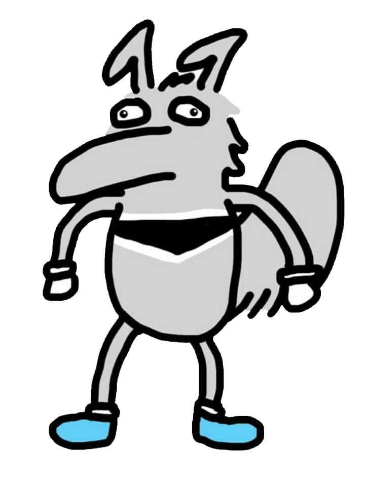

# Frontend Starter Pack
This repository contains starter code for a basic HTML/CSS/Javascript website.

## Intro
The frontend of a website boils down to 3 components:
- how the site is structured (HTML)
- how the site looks (CSS)
- how the site functions (Javascript/JS).

In this demo, we'll be using pure HTML/CSS/Javascript. It is a compilation of HTML, CSS, JS starting ideas and concepts that you can use for your ZotHacks project or whatever project you want.

## How to get this code
1. We highly recommend installing [Git](https://git-scm.com/install/) and cloning the repository.
   
   Run this command to get all of the files in this repository:
   
   ```bash
   git clone https://github.com/HackAtUCI/zothacks-frontend-startercode.git
   ```
2. You could also download the code as a zip by clicking on the green "Code" button and clicking "Download ZIP".

   Then, you can extract into a folder and open the folder in your favorite code editor.
   


## How to run your code
- You can drag the HTML file into your browser to see all of your changes!
- If you use VSCode, there are some extensions that make developing frontend apps much easier.

## Extensions

### Live Server
If you use VSCode, you can get the [Live Server Extension](https://marketplace.visualstudio.com/items?itemName=ritwickdey.LiveServer). 

Any change you make will be directly reflected in the website instead of you having to drag the HTML file into your browser again.

1. Navigate to the Extensions tab in VSCode, search for "live server", click the top option, and click on the blue install button in the top center.
   


2. Select `index.html` and click on the "Go Live" button in the bottom of VSCode. Your browser should automatically open with the HTML file rendered!
   
   

Congratulations! Now whenever you edit your HTML, CSS, or JS file, your changes are automatically reflected in your browser.

Try changing "Hello, world!" to something different and see your changes appear in the browser!


### Live Share
If you use VSCode and need to collaborate on the same project (like in a hackthon!), you can get the [Live Share Extension](https://marketplace.visualstudio.com/items?itemName=MS-vsliveshare.vsliveshare).

This allows multiple people to edit the same file at the same time, just like how multiple people can edit a Google Doc at the same time.

You can also use this with the [Live Server Extension](https://marketplace.visualstudio.com/items?itemName=ritwickdey.LiveServer)! 

**Note: The following steps will require 2 or more computers. One computer (Computer 1) has the code and this extension. Another computer (Computer 2) simply needs to connect to the session (will be explained in the next steps). All other computers can follow Computer 2's steps.**

1. On Computer 1, navigate to the Extensions tab in VSCode, search for "live share", click the top option, and click on the blue install button in the top center.


2. On Computer 1, click on the "Live Share" button in the bottom of VSCode. Click the button. You will be prompted to sign into GitHub or Microsoft.


3. Once you sign in, you will see a notification starting a session and later, `Invitation link copied to clipboard!`. Send this link to Computer 2.


4. On Computer 2, navigate to the link. You can choose to open VSCode locally or use the web. You may be asked to sign in.


5. On Computer 1, you will see a notification to approve someone to join the collaboration session. Click "Accept read-write" so Computer 2 can edit the files.


6. On Computer 2, you will see that the same code from Computer 1 shows up with Computer 1's cursor active.


Congratulations! You can now have multiple users edit the same files at the same time!


## Notes about HTML
There are a few things we want to point out about HTML files. You can look at the comments in `index.html` for detailed examples and explanations.

### 1. Overall structure

Everything is composed of tags. Notice how the `title` tag here has an opening and closing tag to enclose the title.
```html
<title>My App</title>
```

Everything is composed of tags and nested tags. Nesting simply means we place a tag inside another. In this example, the `img` image tag is placed in the `a` anchor tag:
```html
<a href="https://youtu.be/GtL1huin9EE">
    
</a>
```

### 2. Linking CSS
   
Near the top of `index.html`, you'll see this:

```html
<link rel="stylesheet" href="styles.css" />
```

This code allows the styles from `styles.css` to affect your html code. Note that `styles.css` is its own file in the same folder as `index.html`.

### 3. Linking JS
   
Near the bottom of `index.html`, you'll see this:

```html
<script src="script.js"></script>
```

This code allows the javascript code from `script.js` to affect your html (and maybe css) code. Note that `script.js` is its own file in the same folder as `index.html`.


## Resources

### Common Web Dev Terminology
You'll see words like these throughout the documentation and tutorials linked below (and in browser DevTools):

- **HTML** - HyperText Markup Language: the structure and content of a page (headings, paragraphs, links, images).
- **Tag / element** - A building block in HTML, usually written with angle brackets, e.g. `<p>...</p>`. The whole thing including its content is often called an **element** while the name in brackets (`p`) is the **tag**.
- **Attribute** - Extra information on an opening tag (e.g. `href="..."` on `<a>` or `src="..."` on ``).
- **Class and id** - Common HTML attributes used as hooks for CSS and JavaScript. A **class** can be shared by many elements while an **id** should only be used by one element (e.g. the starter HTML uses `id="petr"` for the petr image).
- **CSS** - Cascading Style Sheets: rules that control how HTML looks (colors, fonts, layout, spacing).
- **Selector** - The part of a CSS rule that says which elements get the styles (e.g. a class `.title` or an id `#petr`).
- **Property (CSS)** - The name of a specific style you're controlling on an element, such as `color`, `margin`, or `display`. In CSS you pair each property with a **value**, such as `color: blue`.
- **JavaScript (JS)** - A programming language that runs in the browser to add behavior (clicks, animations, fetching data).
- **Script** - JavaScript code that the browser runs for your page. Often a `.js` file you link using `<script src=...>`.
- **Function** - A named, reusable block of JavaScript you can call to run some logic, optionally with inputs and a return value.
- **Event** - Something that happens in the browser (click, key press, page finished loading) that JavaScript can listen for and react to.
- **DOM** - Document Object Model: the browser's live tree of your HTML that JavaScript can read and change.
- **API** - Application Programming Interface: a defined way for code to talk to something else. Often a web API over the network that returns data your frontend can use.
- **HTTP** - HyperText Transfer Protocol: how the browser and servers exchange requests and responses (e.g. loading a page or sending form data).

For many more definitions see the [MDN Web Docs Glossary](https://developer.mozilla.org/en-US/docs/Glossary).

Google and documentation are your best friends!
- Don't know what an HTML tag does? Look it up or go to the [MDN Docs](https://developer.mozilla.org/en-US/docs/Web/HTML/Reference/Elements).
- Don't know what a selector is or what certain styles do? Look it up or go to the [MDN CSS Docs](https://developer.mozilla.org/en-US/docs/Web/CSS/Reference).
- Don't know what some javascript function does or how to add interactivity to your HTML file? Look it up or go to the [MDN JS Docs](https://developer.mozilla.org/en-US/docs/Learn_web_development/Getting_started/Your_first_website/Adding_interactivity).

If you've never built a website before, here are a few resources to get you started.
- [What is an API?](https://medium.com/@perrysetgo/what-exactly-is-an-api-69f36968a41f) 
- [How to Make API Requests](https://medium.com/swlh/making-use-of-apis-in-your-front-end-c168e343bea3): Get data using a frontend.
- [HTTP Requests](https://www.w3schools.com/tags/ref_httpmethods.asp): How the internet communicates. Whenever you go to a URL or submit a form, there is a request that is sent to get or change information.

If you're feeling more advanced, here are some other resources to expand your front end knowledge,
- [Bootstrap](https://getbootstrap.com/docs/4.3/getting-started/introduction/) - CSS library that containing preset styles
- [SASS/SCSS](https://sass-lang.com/) - CSS scripting framework that can potentially give you a more intuitive view on CSS (nested CSS)
- [Flexbox](https://css-tricks.com/snippets/css/a-guide-to-flexbox/) - Allow you to structure and space out your elements in pure CSS. You can see this in action when you are using the `display: flex;` styling in your container element.
- [React](https://reactjs.org/tutorial/tutorial.html) - A JavaScript framework that allows you to build your website using the idea of components.


## Troubleshooting

### Live Server not updating
If your browser isn't reflecting your latest changes, try clicking "Go Live" again to restart the server. Make sure you opened the Live Server from `index.html` specifically, not just any file in the folder.

### CSS changes not showing
Your browser may be serving a cached version of your stylesheet. Do a hard refresh (`Cmd+Shift+R` on Mac, `Ctrl+Shift+R` on Windows) to force the browser to reload all assets including your CSS.

### JavaScript not working
Open your browser's DevTools (`Cmd+Option+I` on Mac, `F12` on Windows) and check the **Console** tab for error messages. If you're making API requests, check the **Network** tab to see if requests are failing or returning unexpected responses.

### Images not loading
Make sure the image file is in the same folder as `index.html` (or that the path in your `src` attribute matches where the file actually is). File names are **case-sensitive**: `Petr.png` and `petr.png` are treated as different files.
